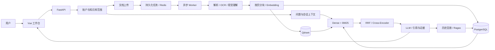

<div align="center">

# 知衡 · Knowledge OS

### 面向私有文档的智能知识检索与问答平台

连接分散的知识，让每一个答案有据可循。

[](https://github.com/leonbuilds-ai/rag-knowledge-assistant/actions/workflows/ci.yml)


<br>


[](LICENSE)

[项目简介](#项目简介) · [产品预览](#产品预览) · [核心能力](#核心能力) · [系统架构](#系统架构) · [快速开始](#快速开始) · [模型接入](#模型接入) · [团队治理](docs/enterprise.md) · [文档](#文档)

</div>

---

## 项目简介

**知衡（Knowledge OS）** 是一套面向企业知识管理与个人知识沉淀的 RAG 应用，将文档管理、多模态解析、混合检索、引用问答与质量评测整合到统一工作台。

从产品手册、业务制度到研究资料，知衡将原始文档转化为可检索的知识单元，结合大语言模型生成带有原文依据的回答。用户可以沿着引用回到文档与页码，通过检索轨迹了解证据如何被找到，并将历史答案纳入持续评测。

> **知识管理 → 证据检索 → 引用问答 → 质量评测**，形成可追溯、可迭代的知识应用闭环。

### 适用场景

| 场景 | 使用方式 |
| --- | --- |
| 企业制度与业务知识 | 汇集制度、流程与操作规范，按问题定位条款及来源 |
| 产品与技术支持 | 将产品说明、使用手册和技术文档组织为可查询的知识库 |
| 研究与资料整理 | 跨文档检索关键信息，保留文献片段和页码依据 |
| RAG 应用开发 | 对比检索策略、检查 Agent 轨迹、复评历史答案与模型效果 |

## 产品预览

### 知识空间

按主题组织知识库，统一管理文档、解析状态与检索分块。


### 引用问答

结合私有文档生成回答，在同一页面查看来源编号、原文片段与页码。


### 质量评测

将历史答案加入评测，结合参考答案与期望文档查看检索指标和 Ragas 结果。


<details>
<summary>查看团队治理与文档版本管理</summary>


</details>

*截图使用演示账号与合成示例资料，展示实际运行界面。*

## 核心能力

### 📚 统一知识空间

支持个人知识空间与团队知识库，提供管理员、编辑、只读角色，以及组织全员或指定成员可见范围。在同一界面完成文档上传、任务跟踪、内容预览与原文管理。支持单文件 **50 MiB** 上传、SHA256 去重、失败重试与重新索引。

摄取任务异步完成文档解析、文本分块、Embedding 与向量索引，任务状态持久化，支持租约恢复与退避重试。文档更新生成新版本，旧版持续服务，新索引就绪后切换；支持历史版本恢复、有效期和目录增量同步。

批量上传逐项展示提交结果，单个文件失败后继续处理其余文件；任务额度暂满时有限重试，支持暂停、继续及仅重试失败项。

### 🔎 多路召回与融合排序

结合 **Qdrant Dense Retrieval** 与持久化中文 **BM25 倒排索引**，兼顾语义表达和关键词命中，通过 **RRF** 融合候选排名，并支持使用 **Cross-Encoder** 进一步精排。

检索范围在查询前根据组织成员、知识库授权与活动版本确定，仅回查命中的候选正文。问答、向量召回、词项检索和历史来源遵循一致的数据访问范围。

### 💬 带有依据的知识问答

回答关联文档名称、页码和原文片段，支持来源编号与证据查看。多轮对话结合服务端会话历史检索，保留问题、答案和引用记录，便于回查与复评。支持真实模型流式输出、停止生成、请求幂等和会话并发保护。

生成后检查引用编号与数字，可选 LLM 核验事实支持和问题可回答性；证据不足时拒答，不支持的生成内容回退为明确标注的原文摘录。

### 🤖 Agent 检索模式

围绕“检索—证据检查—查询改写—生成”组织问答流程。在证据覆盖不足时进行有界关键词改写，对多轮候选合并去重，再统一精排。检索步骤与处理轨迹可在工作台查看。

### 🖼️ 多模态文档理解

支持 **PDF、DOCX、TXT、Markdown、CSV、JSON、HTML 与图片**。PDF 保留页码，Word 文档提取正文与表格；扫描页和图像可接入 **Tesseract OCR** 或 **Qwen 视觉模型**，将图文信息纳入统一检索。

Markdown 按章节和内容块组织证据，保留代码围栏与表格表头，引用可定位到原始文件行号。外链图片保留说明并提示尚未识别，需要图像内容时另行上传图片文件。使用与升级说明见 [Markdown 知识库](docs/markdown-quality.md)。

### 📊 评测与回放

内置 **Hit@5、Recall@5、MRR@5** 检索评测与 Dense / Hybrid 对照，支持通过 **Ragas** 评估忠实度、答案相关性、上下文精确率和召回率。

评测通过独立 Worker 异步运行，前端自动更新状态。历史答案可直接加入评测，复用当时的答案和证据。答案缓存与评审缓存分别管理，减少相同内容的重复生成和评分。

### 🛡️ 团队治理与运行保障

通过可撤销服务端会话、HttpOnly Cookie、OIDC 单点登录、角色授权与操作审计管理访问。登录与问答限流、账户和服务并发上限、存储与请求预算，共同约束资源使用。

平台管理员可在前端保存全局或指定账号配额，新请求即时读取；任务管理支持查看摄取、评测与清理进度，以及取消、重试和故障恢复。PDF 优先读取文字层，并显示逐页解析和向量生成阶段。

删除操作提交持久清理任务，在向量服务恢复后继续重试；Alembic 负责数据库升级，协调备份覆盖数据库、原件与向量快照，并提供完整性校验和空目标恢复保护。健康探针、Prometheus 指标与示例告警规则用于运行诊断。配置方式见[团队治理与可靠性](docs/enterprise.md)。

### 🏠 灵活的私有化部署

支持 **Ollama、vLLM / OpenAI 兼容接口与 SentenceTransformers**，可根据硬件和数据需求选择模型。提供 Docker Compose 与本地开发两种运行方式，覆盖前端、API、独立摄取与评测 Worker、迁移及存储服务。

## 系统架构



| 层次 | 技术与职责 |
| --- | --- |
| 交互层 | Vue 3 · TypeScript · Vite，知识管理、问答与评测工作台 |
| 应用层 | FastAPI · SQLAlchemy · LangChain，接口、会话与模型适配 |
| 检索层 | Qdrant · BM25 · RRF · Cross-Encoder，向量召回与融合排序 |
| 任务与缓存 | Redis · SQL 持久化任务，异步摄取、租约恢复与结果复用 |
| 业务存储 | PostgreSQL，账户、知识库、文档、会话及评测记录 |
| 文档理解 | PyPDF · python-docx · Tesseract · 视觉模型 |
| 评测与交付 | Ragas · Pytest · Ruff · GitHub Actions · Docker Compose |

本地开发也可使用 SQLite 与 Qdrant local。完整数据流与实现细节见 [架构文档](docs/architecture.md)。

## 快速开始

### 方式一：Docker Compose

准备 Docker 与 Compose，克隆仓库并创建部署配置：

```bash
git clone https://github.com/leonbuilds-ai/rag-knowledge-assistant.git
cd rag-knowledge-assistant
cp .env.production.example .env.docker
```

编辑 `.env.docker`，配置存储服务密码、应用密钥与模型连接，然后启动：

```bash
docker compose --env-file .env.docker up --build -d
```

| 入口 | 地址 |
| --- | --- |
| 知识工作台 | [http://localhost:8080](http://localhost:8080) |
| API 文档 | [http://localhost:8010/docs](http://localhost:8010/docs) |

使用宿主机 Ollama、配置 OCR 或调整服务参数，可查阅 [部署指南](docs/deployment.md)。

### 方式二：本地开发

环境要求：**Python 3.12、Node.js 20.19+**，以及可用的模型服务。

```bash
git clone https://github.com/leonbuilds-ai/rag-knowledge-assistant.git
cd rag-knowledge-assistant

python -m venv .venv
source .venv/bin/activate
python -m pip install -e "./backend[dev,ml,evaluation]"

cd frontend
npm ci
cd ..
cp .env.ollama.example .env
```

Windows 可使用 `.venv\Scripts\Activate.ps1` 激活环境，也可使用已有 conda 环境。准备好 Docker 基础服务和模型后，在项目根目录一键启动：

```powershell
.\scripts\dev.ps1
# 使用其他 Conda 环境：.\scripts\dev.ps1 -CondaEnv your-env
# 仅检查现有服务：.\scripts\dev.ps1 -Service status
# 终端已关闭时停止三个服务：.\scripts\dev.ps1 -Service stop
```

脚本默认使用 `cook-rag-1`，在同一个终端启动 API、前端与所需的独立 Worker，按服务名称汇总日志。按 **Ctrl+C** 停止本次启动的进程；已运行的健康服务会被复用并保留。未启用 Redis 时使用 API 内置任务线程。启动器不会自动切换端口，发现其他程序占用端口时会给出明确提示。

其他系统或已激活 Python 环境时，可直接运行 `python scripts/dev.py`。访问 [http://localhost:5173](http://localhost:5173)。启用 Redis 队列时须同时配置 Qdrant server；本次新启动服务的日志保存在 `artifacts/dev/`。

## 模型接入

| 接入方式 | 典型配置 | 用途 |
| --- | --- | --- |
| Ollama | `RAG_LLM_PROVIDER=ollama` | 本地生成与视觉理解 |
| vLLM / OpenAI 兼容 API | `RAG_LLM_PROVIDER=openai` | 自托管或远程模型服务 |
| Ollama Embedding | `RAG_EMBEDDING_PROVIDER=ollama` | 本地语义向量 |
| 兼容 Embedding API | `RAG_EMBEDDING_PROVIDER=openai` | 独立向量模型服务 |
| SentenceTransformers | `RAG_EMBEDDING_PROVIDER=sentence-transformers` | 本地语义编码 |
| Cross-Encoder | `RAG_RERANKER_MODEL` | 检索候选精排 |

Ollama 示例模型为 `qwen3.5:9b` 与 `qwen3-embedding:8b`。视觉模型通过 `RAG_VISION_MODEL` 配置，模型名称、地址、上下文窗口和向量维度均可调整。

项目同时提供轻量演示配置 `.env.example`，使用哈希向量与原文摘录，方便在未接入模型时体验文档管理和检索流程。

## 开始使用

1. **建立知识空间**：注册账户，按业务或主题创建知识库。
2. **导入文档**：上传手册、制度或研究资料，等待解析与索引完成。
3. **提问并查看证据**：选择知识库与问答模式，结合原文引用核对答案。
4. **持续评测**：将答案加入评测集，填写参考答案与期望文档，对比检索策略与模型结果。

仓库提供 [演示文档](examples/company-handbook.md)、[产品说明](examples/product-guide.md) 和 [评测案例](examples/evaluation-cases.json)，可用于体验完整流程。

## 测试与开发

| 检查 | 命令 |
| --- | --- |
| 静态检查 | `python -m ruff check backend scripts` |
| 后端测试 | `cd backend` 后运行 `python -m pytest -q` |
| 前端构建 | `cd frontend` 后运行 `npm run build` |
| 业务回归与检索容量 | `python scripts/benchmark.py` |
| 模型链路验证 | `python scripts/smoke.py` |
| Ragas 评测验证 | `python scripts/smoke.py --with-ragas` |

GitHub Actions 覆盖后端测试、真实 PostgreSQL/Redis/Qdrant 集成回归、合成业务门槛与前端构建；模型与容器验证记录见 [评测与验证](docs/validation.md)。

## 项目结构

```text
rag-knowledge-assistant/
├── backend/
│   ├── app/
│   │   ├── api/             # 账户、知识库、文档、问答与评测接口
│   │   ├── services/        # 文档理解、检索、生成与评测
│   │   ├── models.py        # 业务数据模型
│   │   └── worker.py        # 异步摄取与任务恢复
│   └── tests/               # 接口与检索链路测试
├── frontend/                # Vue 3 知识工作台
├── docs/                    # 架构、部署与评测文档
├── examples/                # 示例文档与评测案例
├── scripts/                 # 开发与验证工具
└── docker-compose.yml       # 应用与基础服务编排
```

## 文档

| 文档 | 内容 |
| --- | --- |
| [系统架构](docs/architecture.md) | 数据流、检索策略、任务恢复与缓存设计 |
| [部署指南](docs/deployment.md) | Docker、本地开发、模型接入与运维 |
| [设计原则](docs/design.md) | 设计目标、技术取舍与相关开源项目 |
| [评测与验证](docs/validation.md) | 自动化检查、模型链路与评测记录 |

## License & Acknowledgements

本项目采用 [MIT License](LICENSE)。感谢 [KnowAgenticRAG](https://github.com/Zhongye1/KnowAgenticRAG) 提供的 Agentic RAG 架构设计启发，以及 LangChain、Qdrant、Ragas 和 Vue 等开源项目。
