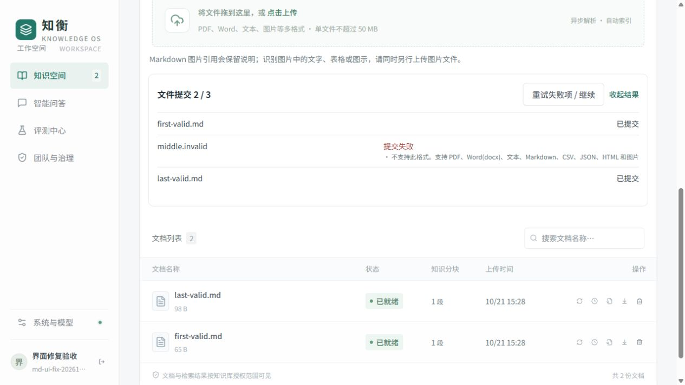

# Markdown 知识库

## 上传与检查

1. 在知识空间选择知识库，一次选择多个 Markdown 文件。
2. 上传区逐项显示“已提交”“已存在”“提交失败”。这些状态指文件提交结果；文档列表中的任务状态反映后续解析与索引进度。
3. 一个文件失败不会中断其余文件。配额暂满会有限重试；失败后可以使用“重试失败项 / 继续”。暂停只中断尚未完成的提交，已接收的解析任务仍在后台执行。
4. 任务完成后打开内容预览，核对章节、原始行号、代码和图片提示，再开始问答。

重新选择文件会追加到当前提交结果中。上传完成后可以收起结果；关闭或刷新页面后，尚未提交的本地文件需要重新选择。已提交的文档和后台任务不会因此丢失。

截图使用隔离测试账号和合成文件，中间文件故意使用不支持的扩展名。

## 章节、代码与图片

解析器按标题、段落、围栏代码块及表格切分。长代码块按完整代码行拆分并补齐语言围栏，长表格续块保留表头。每块携带章节路径与原始文件行范围；多个续块可能共同指向同一原始内容块的行范围。

针对部分网页导出文件将主题和“问题描述 / 原因分析 / 业务场景 / 解决方案”等子节全部压成六级标题的情况，解析器保留最近主题作为这些通用子节的上下文。标准 Markdown 的其余标题层级按原样处理。

网页导出的目录、首页和页脚文字在索引时清理。文档中的维护、赞助等内容会提示分库存放，不自动删除用户文件。

Markdown 图片引用不会自动下载或识别。图片替代文字作为说明保留，并标记“图片内容尚未识别”；没有替代文字时只保留未识别提示。需要据图回答时，请单独上传相应图片，或提供包含图片的 PDF。不要把图片说明视为 OCR 结果。

## 提问与核验

比较问题分别召回两个对象的证据；询问处理方法时，同时保留各自章节中的方案，避免只召回问题成因。“是什么，为什么”一类复合问题同时检索完整问题和核心术语。上下文裁剪优先保留完整句子或代码单元，避免把条件切成半句。

开启 `RAG_CITATION_VERIFIER=llm` 后，生成内容会检查来源支持、问题相关性和子问题完整性；缺少引用时，只能在模型定位支持原句的来源后补齐编号，并再次检查数字。无法通过的内容经过一次有界修订，仍不能核实时返回经核验的摘录或明确拒答。数字核对模式不提供语义正确性保证。

复合条件、写入操作与明确禁止性建议另行核对原文引句，验证引句确实存在。完成规则添加“并且”条件、把行为描述改成操作禁令时采用保守保护；这可能增加拒答和模型调用次数。该检查与完整性评审仍不能代替独立人评。

本地模型的生成和核验仍可能出现共同误判。验收应分别检查术语定义、否定、操作对象、必要条件、命令、数值与跨库范围，不能只看是否有引用或核验是否通过。评测集应同时包含有答案、无答案和仅部分有答案的问题。

引用核验主要检查回答是否受到选定资料支持。课程笔记、网页转载等材料自身的过时或错误观点，需要另外用权威资料和人工参考答案审查。不要把“与原文一致”直接等同于“技术结论正确”。

## 旧文档升级

数据库迁移 `007_chunk_locator` 为分块增加来源定位字段，旧索引仍可查询。新章节结构、行号与图片提示需要重新解析才能生成：在文档列表使用“重新索引”，完成后新版本自动生效，处理中继续使用旧版本。

仅重启 API 不会自动重建全部用户文档。迁移前按部署文档备份，升级后检查 API、Worker 与向量服务状态。
